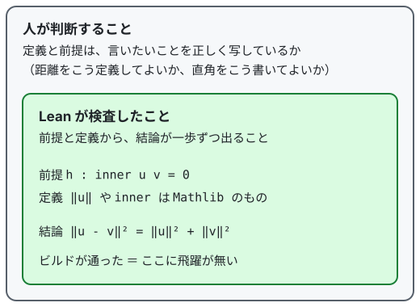

# Lean の「証明が通った」は何を保証したのか

> **想定読者**：Lean を知らないエンジニア。テストや CI の緑は見慣れていて、高校数学（帰納法、二次式の展開、三平方の定理）は覚えている前提で書いた（この前提は書き手の推測。理由は末尾の「この資料が置いた前提」）。
> **省いたもの**：道具の入れ方（[リポジトリの README](../../README.md#道具の入れ方)）、タクティクの網羅、Lean の型理論。
> **所要時間**：13 分。手元で走らせなくても読める。
> **検証方法**：本文に引用した出力とコードは、`checks.json` のコマンドで再実行し、実物と照合している（付録）。

型チェックが通っても、関数が仕様どおりに動くとは限りません。テストは、選んだ入力でしか確かめません。
Lean は、型チェックを「どんな入力でも、この性質が成り立つ」まで広げた道具で、証明の検査も型チェックとして行います。だから、ライブラリや製品の説明にある「形式検証済み」や、レビューで受け取る「Lean で証明した」（人が書いたものでも、AI が書いたものでも）は、テストの緑より強いものに見えます。
**ビルドが通って保証されるのは、書いた前提と定義から、書いた結論まで、飛躍が一歩も無いことです。**
前提と定義が言いたいことを写しているかは保証されないので、同じ「通った」でも、主張の強さは書き方しだいで変わります。期待値を実装から計算してしまったテストが、何も確かめていないのと同じ構造です。

この落とし穴は、プログラムの性質でも同じです。たとえば「ソート関数の出力は昇順」だけを定理にすると、空のリストを返す関数でも通ります（3節）。
この資料は、それを三平方の定理で見せます。例が数学なのは、正しいかどうかを読み手が自分で判定できる題材だからです。読み終えたら、「証明が通った」と聞いたときにどこを読めばよいかが言えるようになります。

<details>
<summary>この資料の構成</summary>

| 節 | 役割 | 見せるもの | なぜ |
| --- | --- | --- | --- |
| 1 | 「通った」が何を保証し、何を保証しないかを言えるようにする | 通ったとき・壊れたときの出力、前提が成り立たない定理、`sorry` | 緑を過大に受け取るのが一番の落とし穴 |
| 2 | 短い証明を1行ずつ追えるようにする | 三平方の定理（ベクトル版）の3行と、各行のあとのゴール | 証明を読めないと、何を示したかも読めない |
| 3 | 前提と定義で主張の強さが変わることを、三平方の定理で見る | 座標版・ベクトル版・Mathlib 版の定理の文 | 「通った」より「何を示したか」を読む習慣のため |
| 4 | TLA+ との違いを一言で言えるようにする | 有限個の総当たりと、無限の場合の証明 | 2つを一括りにしないため |
| 5 | レビューに持ち帰る | チェックリスト | 1〜3 節を、人の「証明した」を読む形にする |

</details>

## 0. 一枚で

| 問い | 答え |
| --- | --- |
| 「通った」で何が言えるか | 書いた前提と定義のもとで、書いた結論が正しい。どの一歩にも飛躍が無い |
| 何が言えないか | 定義と前提が、言いたいことを写しているか。前提が成り立ちえないなら、何も言っていない。`sorry` が残っていれば、その証明は無い |
| 証明はどう読むか | Lean は「まだ示せていないこと」（ゴール）を持っている。1行ごとにゴールが書き換わるので、前後を見比べる |
| TLA+ とどう違うか | 総当たりではないので、無限にある場合もまとめて示せる。そのかわり、証明は人が書く |

## 1. 「通った」が保証すること

Lean では、示したい命題と、その証明を書きます。
証明は**タクティク**（証明を一歩進める命令）を1行ずつ並べたもので、Lean は一歩ずつ検査します。

全部の一歩がつながっていれば、Lean は何も言わずに通します。
`make lean-mathlib`（三平方の定理などの例をビルドする）の最後の行はこうです。

<!-- output: lean-mathlib-build -->
```text
Build completed successfully (18260 jobs).
```

一歩でもつながらなければ、止まった行と、そのとき残っている**ゴール**（まだ示せていないこと）を出します。
次は、「1 + 2 + ... + n の2倍 = n(n + 1)」の帰納法の証明から、帰納法の仮定を使う1行をわざと消したものです（`make lean-broken`）。

<!-- output: lean-broken -->
```text
broken/SumFormulaBroken.lean:25:8: error: Tactic `rewrite` failed: Did not find an occurrence of the pattern
  ?n * ?k + ?m * ?k
in the target expression
  2 * sumTo k + 2 * (k + 1) = (k + 1) * (k + 1 + 1)

case succ
k : Nat
ih : 2 * sumTo k = k * (k + 1)
⊢ 2 * sumTo k + 2 * (k + 1) = (k + 1) * (k + 1 + 1)
```

`:25:8` が止まった行（25 行目）です。
`?n` のように `?` の付いた名前は「何が入ってもよい穴」で、Lean は「（何か）×（共通のもの）＋（何か）×（共通のもの）」という形を探して見つけられなかった、と言っています。
`⊢` の右が、まだ示せていないゴールで、その上の行が手元にある前提です。
前提に帰納法の仮定 `ih` があるのに、ゴールには `2 * sumTo k` が残ったままで、次の変形の形になっていない、と言っています。

**Lean は「だいたい合っている」では通しません。**
ただし、検査するのは「前提と定義から結論が出るか」だけです。
次の定理は、前提 `h : n < 0`（n は 0 より小さい）を置いています。

<!-- source: examples/Vacuous.lean -->
```lean
theorem nonsense (n : Nat) (h : n < 0) : n = 42 := by
  omega                     -- 前提 h が矛盾していることを見つけて、証明を閉じる
```

<!-- output: vacuous -->
```text
エラーなし（定理 nonsense は通った）
```

0 より小さい自然数は無いので、この定理はどんな n についても何も言っていません。
それでも「前提から結論が出る」は正しい（前提が偽なら、何でも出せる）ので、Lean は通します。

もう1つ、`sorry` は「この証明はあとで書く」という仮置きで、Lean は警告を出しますが、エラーにはしません。

<!-- output: sorry -->
```text
Sorry.lean:6:8: warning: declaration uses `sorry`
終了コード 0
```

「ビルドが通った」と聞いたら、警告に `sorry` が無いかも見ます。

ここまでをまとめると、次の図の内側が Lean の保証で、外側は人が読んで判断するところです。



## 2. 証明を1行ずつ追う：三平方の定理

直角三角形の、直角の頂点から出る2辺をベクトル u, v とします。
斜辺は u − v です。
u と v が直交する（内積が 0）なら、斜辺の長さの2乗は、2辺の長さの2乗の和です。

<!-- source: ../../lean/with-mathlib/WithMathlib/Pythagoras.lean -->
```lean
theorem pythagoras_vec (u v : EuclideanSpace ℝ (Fin 2)) (h : inner ℝ u v = 0) :
    ‖u - v‖ ^ 2 = ‖u‖ ^ 2 + ‖v‖ ^ 2 := by
  rw [norm_sub_sq_real]     -- Mathlib の補題「‖u - v‖² = ‖u‖² - 2 × (u と v の内積) + ‖v‖²」で左辺を書き換える
                            -- （(a - b)² = a² - 2ab + b² のベクトル版）
  rw [h]                    -- 前提 h で内積を 0 に置き換える →  ‖u‖² - 2 * 0 + ‖v‖² = ‖u‖² + ‖v‖²
  ring                      -- 2 * 0 = 0 を消せば両辺は同じ
```

1行目の読み方です。

- `(u v : EuclideanSpace ℝ (Fin 2))`：u と v は平面のベクトル。
- `(h : inner ℝ u v = 0)`：前提。u と v の内積は 0（直交している）。`h` はこの前提に付けた名前。
- `:` の右から `:= by` の手前まで：示したいこと。`‖u‖` は u の長さ。

各行のあとのゴールを、Lean に表示させたものが次です（証明の各行の間に、その時点の様子を表示する命令 `trace_state` を挟んだ写し `examples/PythagorasGoals.lean` を走らせた）。
3つのかたまりが、順に「始め」「1行目のあと」「2行目のあと」です。

<!-- output: pythagoras-goals -->
```text
u v : EuclideanSpace ℝ (Fin 2)
h : inner ℝ u v = 0
⊢ ‖u - v‖ ^ 2 = ‖u‖ ^ 2 + ‖v‖ ^ 2
u v : EuclideanSpace ℝ (Fin 2)
h : inner ℝ u v = 0
⊢ ‖u‖ ^ 2 - 2 * inner ℝ u v + ‖v‖ ^ 2 = ‖u‖ ^ 2 + ‖v‖ ^ 2
u v : EuclideanSpace ℝ (Fin 2)
h : inner ℝ u v = 0
⊢ ‖u‖ ^ 2 - 2 * 0 + ‖v‖ ^ 2 = ‖u‖ ^ 2 + ‖v‖ ^ 2
```

| 行 | やったこと | ゴールの変化 |
| --- | --- | --- |
| `rw [norm_sub_sq_real]` | Mathlib にある等式で、左辺を展開した形に書き換える | `‖u - v‖ ^ 2` が `‖u‖ ^ 2 - 2 * inner ℝ u v + ‖v‖ ^ 2` に |
| `rw [h]` | 前提 h（内積 = 0）で置き換える | `inner ℝ u v` が `0` に |
| `ring` | 式を展開・整理して、両辺が同じだと確かめる | `2 * 0` が消えて両辺が一致し、ゴールが無くなる |

ゴールが無くなったところで証明は終わりです。

`rw [h]` の行で、前提 h（直交している）を使っています。
この行が無ければ内積が残り、両辺は一致しません。
証明を追うと、**どの前提がどこで効いているか**が分かります。

`norm_sub_sq_real` は Mathlib（Lean の数学ライブラリ）にある、証明済みの等式です。
このリポジトリは Mathlib をビルド済みの形で取ってくるので、手元で検査し直しているのは自分で書いた証明の部分だけです。
つまりこの「通った」は、Mathlib と Lean 本体を信じたうえでの結果です。依存ライブラリを信じてアプリのテストを回すのと同じ位置づけです。

## 3. 前提と定義で、主張の強さが変わる

`Pythagoras.lean` には、三平方の定理が何通りか入っています。
どれも「通った」ですが、示したことの強さが違います。

一番素朴なのは、座標で置いた版です。
まず、2点の距離の2乗を、座標の差の2乗の和として**定義**します。

<!-- source: ../../lean/with-mathlib/WithMathlib/Pythagoras.lean -->
```lean
def distSq (p q : ℝ × ℝ) : ℝ :=
  (p.1 - q.1) ^ 2 + (p.2 - q.2) ^ 2
```

そのうえで、直角の頂点を原点に、2辺を x 軸と y 軸に置きます。

<!-- source: ../../lean/with-mathlib/WithMathlib/Pythagoras.lean -->
```lean
theorem pythagoras_on_axes (a b : ℝ) : distSq (a, 0) (0, b) = a ^ 2 + b ^ 2 := by
  unfold distSq             -- distSq を定義で開く →  ((a, 0).1 - (0, b).1) ^ 2 + ((a, 0).2 - (0, b).2) ^ 2 = a ^ 2 + b ^ 2
  simp                      -- `simp` は決まりきった簡単化をまとめてやる。組から成分を取り出し、- 0 や 0 - を整理する
```

証明は、定義を開いて整理するだけです。
「距離の2乗 = x 方向の差の2乗 + y 方向の差の2乗」という定義そのものが、x 軸と y 軸が直角であることを前提にした三平方の定理だからです。
**この版は、定義に織り込んだことを取り出して見せただけで、三平方の定理を示したとはほとんど言えません。**

同じファイルの `pythagoras_coord` は、三角形がどこにどんな向きで置かれていてもよい形です。
直角は「C から A へと、C から B への2本のベクトルの内積が 0」という前提 `h` で書きます。

<!-- source: ../../lean/with-mathlib/WithMathlib/Pythagoras.lean -->
```lean
theorem pythagoras_coord (A B C : ℝ × ℝ)
    (h : (A.1 - C.1) * (B.1 - C.1) + (A.2 - C.2) * (B.2 - C.2) = 0) :
    distSq A B = distSq A C + distSq B C := by
```

軸に沿っていない、斜めの直角三角形でも成り立つ、と言える分だけ強くなりました。
ただし、距離の定義は同じ `distSq` のままです。

Mathlib には、角度で直角を書いた三平方の定理があります。
`∠ A C B` は角 ACB の大きさで、`Real.pi / 2` は 90 度です。

`example` は、名前を付けない `theorem` です。

<!-- source: ../../lean/with-mathlib/WithMathlib/Pythagoras.lean -->
```lean
example (A B C : EuclideanSpace ℝ (Fin 2)) (h : ∠ A C B = Real.pi / 2) :
    dist A B * dist A B = dist A C * dist A C + dist B C * dist B C :=
  -- Mathlib の定理に p₁ = A, p₂ = C, p₃ = B を入れ、`.mpr` で「↔ の右から左へ」向きを取り出して、h を渡す。
  (dist_sq_eq_dist_sq_add_dist_sq_iff_angle_eq_pi_div_two A C B).mpr h
```

元の Mathlib の定理は「直角である ⇔ a² + b² = c²」という同値の形で、逆向きも込みです。
ファイルのコメントによると、平面に限らず何次元でも使える形で書かれています（Mathlib のソースは読んでいないので、この資料では未検証）。

| 版 | 直角の書き方 | 距離 | 言えたこと |
| --- | --- | --- | --- |
| `pythagoras_on_axes` | 2辺を x 軸・y 軸に置く | 自作の `distSq` | 定義をほぼそのまま言い直した |
| `pythagoras_coord` | 内積 = 0 という前提 | 自作の `distSq` | どこに、どの向きに置いた直角三角形でも |
| `pythagoras_vec`（2節） | 内積 = 0 という前提 | Mathlib の長さ `‖ ‖` | 同上を、Mathlib のベクトルの言葉で |
| Mathlib の定理 | 角度が 90 度 | Mathlib の `dist` | 角度で書いた直角から。逆も込み |

どれも、Lean の答えは同じ「通った」です。
違いは定理の文と定義に書いてあり、それを読むのは人です。
自作の定義（`distSq`）が言いたいことを写しているかは、自分で読むしかありません。Mathlib の定義を使えば、読む対象が Mathlib の定義に移ります。

プログラムの性質でも同じことが起きます。
たとえば「ソート関数の出力は昇順に並んでいる」だけを定理にすると、どんな入力にも空のリストを返す関数でも成り立ってしまいます（空のリストは昇順だから）。
「出力は入力の並べ替えである」も文に入れて、初めて言いたいことになります（この例は Lean では書いていない）。

## 4. TLA+ との違い

`lean/basics/Basics/FirstSteps.lean` に、2つの考え方が並んでいます。

<!-- source: ../../lean/basics/Basics/FirstSteps.lean -->
```lean
example : ∀ n, n < 10 → n * n < 100 := by
  decide                  -- n = 0, 1, ..., 9 の 10 通りを計算して、どれも成り立つと確かめる
```

<!-- source: ../../lean/basics/Basics/FirstSteps.lean -->
```lean
theorem add_self_eq_two_mul (n : Nat) : n + n = 2 * n := by
  omega                   -- 一次式の等式なので omega が証明を組み立てる
```

上は有限個を全部計算して確かめる、総当たりです。
TLA+ は、同時に動く処理の設計を模型に書き、検査器 TLC がありうる状態を総当たりで調べて、壊れる手順（反例）を出す道具です。TLC がやるのも、この総当たりの考え方です。
下は「どんな自然数 n でも」を、場合を並べずに理屈で示しています。n は無限にあるので、総当たりではできません。

三平方の定理も同じで、実数の三角形は無限にありますが、Lean は文字のまま一度に示しました。
そのかわり、TLA+ では機械が反例を探すのに対し、Lean では証明を人が書きます。

TLA+ 側の話は [TLA+ の「エラーなし」は何を保証したのか](../tla/README.md) にあります。
どちらの道具も、「書いた前提のもとで」の結果を返すところは同じです。

## 5. 「証明が通った」と聞いたときに読むところ

- [ ] 定理の文（`:` の右）を読み、示したことが言いたいことと合っているか
- [ ] 前提（`(h : ...)`）を読み、成り立ちうるか、強すぎないか
- [ ] 自作の定義（`def`）を読み、結論を織り込んでいないか
- [ ] 警告に `sorry` が無いか
- [ ] 何を信じた結果か（Mathlib などの依存と Lean 本体）

## 6. 理解度チェック

**問1.** 同僚が「Lean で、このソート関数の性質を証明した。ビルドも通った」と言う。まず何を読むか。

<details>
<summary>答え</summary>

証明ではなく、定理の文と前提と定義です。
ビルドが通ったことで分かるのは「書いた前提と定義から、書いた結論が出る」までで、その結論が言いたい性質かは文を読まないと分かりません（1節、3節）。
警告に `sorry` が無いかも見ます。

</details>

**問2.** 2節の証明から `rw [h]` の行を消すと、どうなるか。

<details>
<summary>答え</summary>

通らなくなります。
内積が 0 だと知らないまま `ring` が両辺を比べるので、一致しません。
実際に消した写し（`examples/PythagorasWithoutH.lean`）では、Lean はこう返します。

<!-- output: pythagoras-without-h -->
```text
  The `ring` tactic failed to close the goal. Use `ring_nf` to obtain a normal form.
error: unsolved goals
⊢ ‖u‖ ^ 2 - inner ℝ u v * 2 + ‖v‖ ^ 2 = ‖u‖ ^ 2 + ‖v‖ ^ 2
```

ゴールに内積 `inner ℝ u v` が残っています。
前提 h（直交している）を使っているのは `rw [h]` の1行だけなので、そこを消すと直角であることが証明のどこにも入りません。

</details>

**問3.** `pythagoras_on_axes` が通ったことは、「三平方の定理を Lean で示した」と言ってよい根拠になるか。

<details>
<summary>答え</summary>

ほとんどならない。
距離の2乗を「x 方向の差の2乗 + y 方向の差の2乗」と定義した時点で、三平方の定理を織り込んでいるからです（3節）。
示したのは、その定義を言い直したことです。

</details>

**問4.** TLA+ の TLC は、在庫の引き当ての模型を「3人が在庫2個を取り合う場合」に限って総当たりで調べる。Lean の三平方の定理は、何個の三角形を調べたか。

<details>
<summary>答え</summary>

1つも「調べて」はいません。
三角形を1つずつ試すのではなく、文字（u, v）のまま、どの三角形でも成り立つことを一度に示しています（4節）。
だから無限にある場合も扱えますが、そのかわり証明は人が書きます。

</details>

## 7. 持ち帰ること

「証明が通った」と聞いたら、**証明ではなく、定理の文と前提と定義を読む**。通ったことが保証するのは、そこから先に飛躍が無いことだけです。

## 付録：再現

```sh
make lean-mathlib   # 1節のビルド（初回は Mathlib のビルド済みを約 7GB 取ってくる）
make lean-broken    # 1節の、壊した証明のエラー
make lean           # 4節の FirstSteps.lean を含む、Mathlib なしの例
```

| ファイル | 中身 |
| --- | --- |
| `lean/with-mathlib/WithMathlib/Pythagoras.lean` | 三平方の定理（座標版、ベクトル版、Mathlib の定理） |
| `lean/basics/broken/SumFormulaBroken.lean` | 1節の、わざと壊した証明 |
| `lean/basics/Basics/FirstSteps.lean` | 4節の、総当たりと理屈の比較 |
| `docs/lean/examples/Vacuous.lean` | 1節の、前提が成り立ちえない定理 |
| `docs/lean/examples/Sorry.lean` | 1節の、`sorry` で飛ばした定理 |
| `docs/lean/examples/PythagorasGoals.lean` | 2節の、各行のあとのゴールを表示する写し |
| `docs/lean/examples/PythagorasWithoutH.lean` | 理解度チェック 問2 の、`rw [h]` を消した写し |
| `docs/lean/checks.json` | 本文の出力を再生成して照合するコマンド |

検証は、リポジトリの直下で `npm i` をしたあと、explainer スキルの `verify-doc.mjs` にこのディレクトリを渡して走らせる。

## 付録：この資料が置いた前提

この資料は「TLA+ も Lean も知らない人向け」という依頼で書きました。それ以外の読み手の像は、書き手の推測です。

- 高校数学（数列、帰納法、二次式の展開、三平方の定理、背理法）は分かる（理由：リポジトリの README がこの範囲を想定読者にしているため）
- Web のバックエンドやアプリを書くエンジニアで、テストや CI の緑は見慣れている（理由：リポジトリの TLA+ の例の題材から）
- チームのナレッジとして後から読み返し、1本に 10〜15 分を使う

読み手の像が違っていたら直したいので、次を教えてください。

- 帰納法や三平方の定理の高校での証明を、どのくらい覚えているか（忘れているなら、2節の前に高校の証明を1段落足す）
