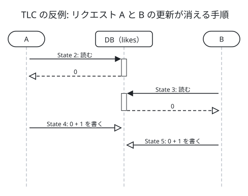

# TLA+ の「エラーなし」は何を保証したのか

> **想定読者**：TLA+ を知らない、Web のバックエンドやアプリを書くエンジニア。SQL の `UPDATE`、トランザクション、ロックは知っている前提で書いた（この前提は書き手の推測。理由は末尾の「この資料が置いた前提」）。
> **省いたもの**：道具の入れ方（[リポジトリの README](../../README.md#道具の入れ方)）、TLA+ の文法の網羅、形式手法の一般論。
> **所要時間**：12 分。手元で走らせなくても読める。
> **検証方法**：本文に引用した出力とコードは、`checks.json` のコマンドで再実行し、実物と照合している（付録）。

更新の消失、デッドロック、在庫の売りすぎ。
「同時に動く処理が、割り込まれる順番しだいで壊れないか」という心配は、TLA+ の検査器 TLC に、ありうる順番を総当たりで調べさせられます。
ただし TLC の「エラーなし」は、**自分で書いた模型を、自分で決めた大きさで調べ尽くした**という結果であって、証明でも、実装の保証でもありません。
この資料は、その2つを、自分の設計レビューで使える形で伝えます。

<details>
<summary>この資料の構成</summary>

| 節 | 役割 | 見せるもの | なぜ |
| --- | --- | --- | --- |
| 1 | 自分の設計が TLA+ の出番かを判定する | 向く・向かないの表、模型の大きさ | 読み終えて最初に使うのはこの判定 |
| 2 | 反例の出力を読めるようにする | 更新の消失とデッドロックの、TLC の実際の出力と図 | TLC の答えの半分は反例。読めないと使えない |
| 3 | 「エラーなし」の範囲を言えるようにする | 在庫の例の状態数、直した版の模型 | 緑を過大に受け取るのが一番の落とし穴 |
| 4 | Lean との違いを一言で言えるようにする | 短い表 | 2つを一括りにしないため |
| 5 | 設計レビューに持ち帰る | チェックリスト | 1〜3 節を、自分の設計に当てる形にする |

</details>

## 0. 一枚で

| 問い | 答え |
| --- | --- |
| これは TLA+ で検査する話か | 「複数の処理が同じものを触り、割り込まれる順番しだいで壊れないか」なら向く。1つの関数の計算の正しさや、性能は向かない |
| 反例はどう読むか | `Error:` の行が結論。`State 1` から下が、最初の状態から壊れる状態までの手順。前の State と見比べて、変わった変数を追う |
| 「エラーなし」で何が言えるか | 書いた模型で、設定した大きさのとき、たどり着ける状態を全部調べて、書いた条件は破れなかった。それ以上（何人でも大丈夫、実装も大丈夫）は言っていない |
| Lean とどう違うか | TLA+ は有限の場合を総当たりする。Lean は人が書いた証明を検査し、無限の場合もまとめて示せる |

## 1. 自分の設計は、TLA+ の出番か

TLA+ で書くのは3つだけです。

1. 最初の状態
2. 起こりうる一手（「A が DB を読む」「B が書く」など）
3. 守ってほしい条件（どの状態でも成り立っていてほしいこと。**不変条件**と呼ぶ）

「誰が先に動くか」は書きません。
検査器の TLC が、ありうる順番を全部試し、条件が破れる順番があればその手順を出します。

この性質から、向く話と向かない話が分かれます。

| 向く | 向かない |
| --- | --- |
| 2つのリクエストが同じ行を読んで書き戻す（更新の消失） | 1つの関数の計算が正しいか（単体テストや Lean の領分） |
| 2つのトランザクションがロックを取り合う（デッドロック） | 応答が速いか、メモリが足りるか |
| 在庫の引き当て、二重送信、リトライと重複実行 | 外部 API が仕様どおりに返すか |
| キューの再配信、キャッシュと DB のずれ | 画面の見た目、使いやすさ |

判定の目安は2つです。

- 2つ以上の処理が、同じものを、途中で割り込まれうる形で触るか。
- 「壊れた」を1行の条件で書けるか（「2人とも終わったら、いいね数は 2」「在庫は負にならない」）。

両方 yes なら、TLA+ で小さな模型を書く価値があります。

手間の目安として、次の節で使う「いいね数」の模型は、コメントと空行を除いて 25 行です（`examples/count-lines.sh` で数えた）。
TLC は、その反例を1秒かからずに返します（出力の `Finished in 00s`）。

次の節の例は、わざと答えの分かっている不具合（更新の消失）にしています。
結論を知っている題材なら、TLC の出力の読み方だけに集中できるからです。
定石（`UPDATE ... SET likes = likes + 1`、ロック順の統一）で潰せる不具合なら、模型を書くまでもないこともあります。
TLA+ が効くのは、リトライと重複実行が重なるような、定石が効いているかを頭で追い切れない組み合わせのときです（この資料には、その規模の例は入れていません）。

## 2. 反例を読む

例は、「いいね数」を 1 増やす処理です。
2つのリクエスト A, B が、どちらも「DB から読む → 読んだ値 + 1 を書き戻す」の2手で動きます。
2つとも終われば 2 になっていてほしい。

守ってほしい条件（不変条件）は、模型の中で1行です。

<!-- source: ../../tla/01_lost_update/LostUpdate.tla -->
```tla
NoLostUpdate == (\A r \in Reqs : pc[r] = "done") => likes = 2
```

「すべてのリクエスト r について `pc[r]`（r がどこまで進んだか）が `"done"` なら、`likes` は 2」と読みます。
`pc` と、各リクエストが読んだ値を持つ `seen` は、リクエストごとの欄を持つ表です。

<details>
<summary>2手（読む・書く）の模型のコード（読まなくても先へ進める）</summary>

`/\` は「かつ」、`'` の付いた変数は「この一手のあとの値」です。

<!-- source: ../../tla/01_lost_update/LostUpdate.tla -->
```tla
Read(r) ==
  /\ pc[r] = "read"                         \* r がまだ読んでいないときだけ起こせる
  /\ seen' = [seen EXCEPT ![r] = likes]     \* r の手元の値を、今の likes にする（EXCEPT は「r の欄だけ書き換えた表」）
  /\ pc' = [pc EXCEPT ![r] = "write"]       \* r は次に書く番になる
  /\ UNCHANGED likes                        \* DB の値は変わらない

\* 一手その2: リクエスト r が DB に書き戻す。
Write(r) ==
  /\ pc[r] = "write"                        \* r が読み終えているときだけ起こせる
  /\ likes' = seen[r] + 1                   \* 「読んだときの値 + 1」を書く（今の likes ではない。ここが問題）
  /\ pc' = [pc EXCEPT ![r] = "done"]        \* r は終わり
  /\ UNCHANGED seen                         \* 手元の値は変わらない
```

</details>

`make tla-lost-update` で TLC に調べさせると、こう返ってきます（起動時のメッセージは省いた）。
`[A |-> 0, B |-> 0]` は「A の欄が 0、B の欄が 0」の表です。

<!-- output: tlc-lost-update -->
```text
Error: Invariant NoLostUpdate is violated.
Error: The behavior up to this point is:
State 1: <Initial predicate>
/\ seen = [A |-> 0, B |-> 0]
/\ pc = [A |-> "read", B |-> "read"]
/\ likes = 0

State 2: <Read line 33, col 3 to line 36, col 20 of module LostUpdate>
/\ seen = [A |-> 0, B |-> 0]
/\ pc = [A |-> "write", B |-> "read"]
/\ likes = 0

State 3: <Read line 33, col 3 to line 36, col 20 of module LostUpdate>
/\ seen = [A |-> 0, B |-> 0]
/\ pc = [A |-> "write", B |-> "write"]
/\ likes = 0

State 4: <Write line 40, col 3 to line 43, col 19 of module LostUpdate>
/\ seen = [A |-> 0, B |-> 0]
/\ pc = [A |-> "done", B |-> "write"]
/\ likes = 1

State 5: <Write line 40, col 3 to line 43, col 19 of module LostUpdate>
/\ seen = [A |-> 0, B |-> 0]
/\ pc = [A |-> "done", B |-> "done"]
/\ likes = 1

13 states generated, 12 distinct states found, 3 states left on queue.
```

読む場所は4つです。

- 1行目が結論です。条件 `NoLostUpdate` が破れる状態に、たどり着けた。
- `State 1` から `State 5` が、最初の状態から破れた状態までの手順です。上から順に時間が進みます。
- `<Read line 33 ...>` は「この状態に来るために起きた一手」です。ただし、A と B のどちらが動いたかは書いてありません。`pc` の欄を前の State と見比べて、変わった方が動いた方です。
- `/\ 変数 = 値` が、その時点の全部の変数です。

この手順を、誰が何をしたかで並べ直すと次の図になります（上の出力から機械的に作った図）。



B は、A が書く前の値（0）を持ったまま書きました。
**2つとも終わったのに likes は 1 で、A の更新が消えています。**

最後の行の `12 distinct states found` は、反例が見つかるまでに調べた状態の数です。
`3 states left on queue` は、反例が見つかった時点で止めたので、調べ残しがあるという意味です。
TLC は手数の少ない順に調べる（出力の冒頭の `breadth-first search`）ので、出てくる反例はいちばん短い手順です。

条件を書かなくても TLC が見つけるものが1つあります。「まだ終わっていないのに、誰も次の一手を起こせない状態」、つまりデッドロックです。
`tla/02_deadlock/` は、2つのトランザクションが逆の順でロックを取る模型で、不変条件を1つも書いていませんが、TLC はこう返します。

<!-- output: tlc-deadlock -->
```text
Error: Deadlock reached.
Error: The behavior up to this point is:
State 1: <Initial predicate>
/\ owner = [a |-> "free", b |-> "free"]
/\ step = [T1 |-> 0, T2 |-> 0]

State 2: <Acquire line 31, col 3 to line 35, col 45 of module Deadlock>
/\ owner = [a |-> "T1", b |-> "free"]
/\ step = [T1 |-> 1, T2 |-> 0]

State 3: <Acquire line 31, col 3 to line 35, col 45 of module Deadlock>
/\ owner = [a |-> "T1", b |-> "T2"]
/\ step = [T1 |-> 1, T2 |-> 1]
```

`owner` は各行のロックを誰が持っているか、`step` は各トランザクションが何個目まで取ったかです。
State 3 で、T1 が a を、T2 が b を持ったまま、互いに相手の行を待っています。どちらも次の一手を起こせません。
ロックを取る順番を全員 a → b にそろえた版（`DeadlockFixed.tla`）は、`make tla-deadlock-fixed` でエラーなしになります。

## 3. 「エラーなし」の範囲

### 3.1 総当たりであって、証明ではない

`tla/03_stock/` は在庫の引き当てです。
人数と在庫数を模型の中で決めず、TLC への指示書（`Stock.cfg`）で決めます。
条件は「在庫は負にならない」「残りの在庫 + 売れた数 = 最初の在庫数」の2つです。
買う一手は、在庫の確認と引き算が1つの一手になっています（SQL なら `UPDATE items SET stock = stock - 1 WHERE ... AND stock > 0` の1文）。

<!-- source: ../../tla/03_stock/Stock.tla -->
```tla
Buy(b) ==
  /\ result[b] = "waiting"                      \* b がまだ試していない
  /\ stock > 0                                  \* 在庫がある
  /\ stock' = stock - 1                         \* 1個減らす
  /\ result' = [result EXCEPT ![b] = "bought"]  \* b は買えた
```

指示書の設定は、3人が在庫2個を取り合う場合です。

<!-- source: ../../tla/03_stock/Stock.cfg -->
```text
CONSTANTS
  Buyers = {"b1", "b2", "b3"}
  InitialStock = 2
```

<!-- output: tlc-stock -->
```text
Model checking completed. No error has been found.
16 states generated, 10 distinct states found, 0 states left on queue.
```

`0 states left on queue` は、調べ残しが無いことです。
たどり着ける 10 個の状態を全部調べ、どれでも2つの条件が成り立った、という意味です。

同じ模型を、6人・在庫3個で調べ直すと、状態は 182 個に増えます（指示書は `examples/Stock-6buyers-3stock.cfg`）。

<!-- output: tlc-stock-6x3 -->
```text
Model checking completed. No error has been found.
357 states generated, 182 distinct states found, 0 states left on queue.
```

どちらの結果も、言っているのは「この人数と在庫数では大丈夫だった」だけです。
100人・在庫50個の場合も、「何人でも」も、TLC は調べていません。
人数を増やすと状態の数は急に増えるので、いつかは調べ尽くせなくなります。

実務では、これでも役に立つことが多いです。
順番の不具合の多くは、2〜3個の処理の小さな組み合わせで、もう現れるからです。
ただしそれはよく言われる経験則で、TLC が保証したことではありません（この資料でも確かめていません）。
「どんな大きさでも」と言い切りたいなら、証明が要ります（[Lean の資料](../lean/README.md)の領分です）。

### 3.2 模型は実装ではない

更新の消失の直した版（`LostUpdateFixed.tla`）は、読むのと書くのを、割り込まれない一手にまとめたものです。

<!-- source: ../../tla/01_lost_update/LostUpdateFixed.tla -->
```tla
Incr(r) ==
  /\ pc[r] = "todo"                     \* r がまだ済んでいないときだけ起こせる
  /\ likes' = likes + 1                 \* この一手の直前の likes に 1 を足す（間に他人は割り込めない）
  /\ pc' = [pc EXCEPT ![r] = "done"]    \* r は終わり
```

<!-- output: tlc-lost-update-fixed -->
```text
Model checking completed. No error has been found.
5 states generated, 4 distinct states found, 0 states left on queue.
```

この緑が言っているのは、「`likes + 1` を割り込まれずに書けるなら、更新は消えない」です。
SQL なら `UPDATE posts SET likes = likes + 1 WHERE ...` に当たります。

TLC は、次のどれも確かめていません。

- 実際のコードが、本当にその1文の SQL を投げているか（ORM が読んでから書く2文に分けていないか）。
- DB が、その1文を本当に割り込まれずに実行するか。
- 模型に書かなかったもの（リトライ、タイムアウト、3つ目のリクエスト）が起きても大丈夫か。

**模型に「割り込まれない」と書いたのは人で、TLC はそれを前提として受け取っただけです。**
模型と実装がずれていないかは、コードレビューやテストで別に確かめます。

同じ理由で、条件を書き忘れたものは、破れても報告されません。
TLC が調べるのは、指示書に書いた不変条件（と、既定で有効なデッドロックの検査）だけです。
TLC は「次の一手が1つも無い状態」をすべてデッドロックと呼ぶので、全員が正常に終わって止まった状態もそれに当たります。
そのため `LostUpdate.cfg` はデッドロックの検査を切っていて、これも人が決めた範囲です。

## 4. Lean との違い

| | TLA+（TLC） | Lean |
| --- | --- | --- |
| 書くもの | 仕組みの模型と、守ってほしい条件 | 示したい命題と、その証明 |
| 機械がやること | たどり着ける状態を全部調べる | 証明の一歩一歩が正しいかを検査する |
| だめなとき | 条件が破れるまでの手順（反例） | 証明が止まった行と、残っている示すべきこと |
| 言える範囲 | 設定した大きさの場合だけ | 文字で書いた「すべての場合」 |
| 考えるのは | 模型と条件。順番は機械が探す | 証明そのもの。機械は検査する |

共通するのは、どちらも「書いた前提のもとで」の結果だということです。
Lean 側の話は [Lean の「証明が通った」は何を保証したのか](../lean/README.md) にあります。

## 5. 自分の設計に当てる前のチェックリスト

- [ ] 2つ以上の処理が、同じものを、割り込まれうる形で触るか
- [ ] 「壊れた」を1行の条件で書けるか
- [ ] 模型の「一手」は、実装で本当に割り込まれない単位か（1文の SQL、1回のロックの中など）
- [ ] 調べる大きさ（人数・個数）を決めたか。その大きさで足りると考える理由を言えるか
- [ ] 「エラーなし」を報告するとき、模型の前提と調べた大きさを一緒に書いたか

## 6. 理解度チェック

**問1.** 「ユーザーのプロフィール画像を縮小する関数が、縦横比を保つか」を TLA+ で検査するのは向いているか。

<details>
<summary>答え</summary>

向いていない。
処理が1つで、順番の組み合わせが無いからです。
単体テストか、言い切りたいなら Lean のような証明の道具の話です（1節の表）。

</details>

**問2.** 反例の出力に `State 3: <Read line 33, ...>` とある。この一手で動いたのが A か B かは、どこを見れば分かるか。

<details>
<summary>答え</summary>

`State 2` と `State 3` の `pc` の欄を見比べ、値が変わった方です。
2節の出力では、B の欄が `"read"` から `"write"` に変わっているので、B が読みました。

</details>

**問3.** 在庫の模型が、3人・在庫2個で「エラーなし」だった。「この在庫の引き当ては、売りすぎない」と報告してよいか。

<details>
<summary>答え</summary>

そのままでは言いすぎです。
言えるのは「この模型で、3人・在庫2個の場合を全部調べて、売りすぎる状態は無かった」までです（3.1 節）。
さらに、模型の `Buy` が1つの一手（割り込まれない）になっていることが、実装の SQL でも成り立つかは別に確かめる必要があります（3.2 節）。

</details>

**問4.** 直した版の模型が「エラーなし」になったのに、本番で更新が消えた。考えられる理由を1つ挙げよ。

<details>
<summary>答え</summary>

模型では「読んで足して書く」を割り込まれない一手と書いたが、実装は読んでから書く2文の SQL だった、などです。
TLC は模型を調べただけで、実装が模型どおりかは調べていません（3.2 節）。

</details>

## 7. 持ち帰ること

TLC の「エラーなし」を聞いたら、**どの模型を、どの大きさで調べたか**を一緒に聞く。それが、この緑の届く範囲です。

## 付録：再現

```sh
make tla-lost-update        # 2節の反例
make tla-stock              # 3.1節（3人・在庫2個）
make tla-lost-update-fixed  # 3.2節
```

| ファイル | 中身 |
| --- | --- |
| `tla/01_lost_update/` | 更新の消失。壊れている版と直した版 |
| `tla/02_deadlock/` | デッドロック。壊れている版と直した版 |
| `tla/03_stock/` | 在庫の引き当て |
| `docs/tla/examples/Stock-6buyers-3stock.cfg` | 3.1 節の、6人・在庫3個の指示書 |
| `docs/tla/figures/trace-to-sequence.mjs` | TLC の反例の出力から、2節の図を作るスクリプト |
| `docs/tla/checks.json` | 本文の出力と図を再生成して照合するコマンド |

検証は、リポジトリの直下で `npm i` をしたあと、explainer スキルの `verify-doc.mjs` にこのディレクトリを渡して走らせる。

## 付録：この資料が置いた前提

この資料は「TLA+ も Lean も知らない人向け」という依頼で書きました。それ以外の読み手の像は、書き手の推測です。

- Web のバックエンドやアプリを書くエンジニア（理由：このリポジトリの例が、更新の消失・デッドロック・在庫の引き当てを題材にしているため）
- チームのナレッジとして後から読み返し、1本に 10〜15 分を使う

読み手の像が違っていたら直したいので、次を教えてください。

- 読んだあと、設計レビューに TLA+ を入れるかを決めたいのか、まず知っておきたいだけか（前者なら 1 節と 5 節を厚くする）
